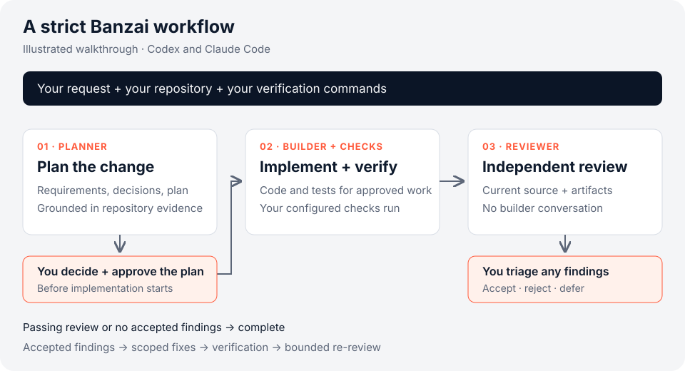

<p align="center">
  <picture>
    <source media="(prefers-color-scheme: dark)" srcset="assets/logo/banzai-logo-dark.svg">
    <source media="(prefers-color-scheme: light)" srcset="assets/logo/banzai-logo-light.svg">
    
  </picture>
</p>

# Banzai — Spec-driven AI development for Codex and Claude Code

[](https://www.npmjs.com/package/@parabolic-technologies/banzai)
[](https://github.com/Parabolic-Technologies/banzai/actions/workflows/ci.yml)
[](LICENSE)

Turn a development request into requirements, plans, code, tests, and review
evidence. Banzai coordinates your coding agents while keeping you in control of
architecture decisions, plan approval, and review findings.

Small changes take a lightweight path. Complex changes get an approved plan
and independent review.

[Quick start](packages/orchestrator/README.md#quick-start) ·
[Your first task](documentation/getting-started.md) ·
[Walkthrough](#the-loop) · [Documentation](documentation/README.md) ·
[Report an issue](https://github.com/Parabolic-Technologies/banzai/issues) ·
[Contribute](CONTRIBUTING.md)

## Why Banzai?

- **Independent review.** In the strict workflow, the reviewer starts without
  the builder's conversation and reports findings for you to triage. You can
  use a different model family for implementation and review.
- **Human control.** You decide on architecture, approve the plan, and accept,
  reject, or defer review findings. Only accepted findings reach the fixer.
- **Durable evidence.** Requirements, decisions, plans, code, tests, and review
  artifacts stay in your project. Banzai runs your configured verification
  commands before strict review.
- **Work sized to the task.** The planner chooses `quick-fix`, `feature`, or
  `strict`. Lightweight routes finish after implementation and verification;
  uncertain or escalated work falls back to strict.

## Two Parts

Banzai ships as two separately installed parts:

| Part         | What it is                                                                                                                                                                                                             |
| ------------ | ---------------------------------------------------------------------------------------------------------------------------------------------------------------------------------------------------------------------- |
| Orchestrator | The local `banzai` CLI, distributed as `@parabolic-technologies/banzai` on npm. Coordinates the selected workflow, runs configured checks, and presents human decisions. Strict work includes an independent reviewer. |
| Plugin       | Workflow skills for Claude Code and Codex. Standalone skills share guidance and policies with embedded orchestrator phases.                                                                                            |

Use the orchestrator to coordinate a complete run, or use the
[plugin directly](#using-the-plugin-without-the-orchestrator) to guide an agent
session. The CLI and plugin have separate installation steps.

## The Loop



This illustrates the strict workflow, not a recorded model run. The
[walkthrough and example request](packages/orchestrator/README.md#workflow-walkthrough)
show how to approach a task; its route and results depend on the actual project.

```text
banzai
  -> select            planner, read-only: quick-fix | feature | strict
  -> quick-fix         implementer -> verification -> done
  -> feature           implementer -> verification -> done
  -> strict
       -> plan         requirements, conditional architecture, development planning
       -> [you: ADR decisions and plan approval]
       -> implementation -> verification -> independent review
       -> passing review -> done
       -> changes requested -> [you: finding triage]
          -> no accepted findings -> done by human triage
          -> accepted findings -> accepted-only fixes -> verification -> re-review
```

Runner phases receive canonical instructions, shared guidance and applicable
policies directly; they do not load or chain standalone chat skills. Selection
remains prompt-only.

Automatic selection is the default. The planner chooses the smallest safe route
from the request and Banzai escalation rules, prints the route, reason, and
phase responsibilities, and falls back to `strict` whenever a lite route is uncertain.

In strict work, compatible planning, implementation, and fixes can share a
builder session lineage. The primary reviewer starts fresh with no builder
transcript and never fixes its own findings. You can configure a different
model family for review; independent review does not require a vendor switch.
Lightweight routes complete after implementation and configured verification.

## Install

Use a Git repository on macOS or Linux. Setup works before the first commit;
create that commit before starting a task.
For the orchestrator, you need:

- Node.js **22.20.0+ within major 22**, or **24.11.1+ within major 24**;
- Git, **Codex CLI 0.145.0+**, and **Claude Code 2.1.218+**;
- subscription authentication in both model clients;
- the Banzai plugin installed in both clients as shown below.

Banzai runs the local `codex` and `claude` executables. It does not require API
keys or call vendor APIs directly. Model work uses those clients' services and
subscription limits; running the orchestrator locally does not make model
inference offline. Use a regular terminal for the CLI.

Install the orchestrator in your terminal:

```sh
npm install --global @parabolic-technologies/banzai
banzai --help
```

Install the plugin inside Claude Code:

```text
/plugin marketplace add https://github.com/Parabolic-Technologies/banzai.git
/plugin install banzai@banzai-plugins
```

For Codex, run these commands in your terminal:

```sh
codex plugin marketplace add https://github.com/Parabolic-Technologies/banzai.git
codex plugin add banzai@banzai-plugins
```

The npm package installs the CLI and its runtime dependencies. The plugin and
model clients are separate installations. For CLI development from a source
checkout, see [development setup](documentation/orchestrator.md#setup) and
[Contributing](CONTRIBUTING.md).

Running Banzai from inside another agent's sandbox can hide Claude Code's
Keychain login or make Codex's state directory read-only. Both conditions get
their own diagnostics; run `banzai` from a regular terminal, or see the
[sandbox notes](documentation/orchestrator.md#model-configuration).

## Configure Each Project Once

From your repository root:

```sh
banzai init
```

Choose models and effort for planning, implementation, and review. Use
`banzai model` later to change them. Init then offers explicit project setup
with an available client. Exit the client to return to Banzai; it rechecks
guidance and starts no task automatically. Use `banzai setup` to continue later,
or invoke the skill manually:

- Claude Code: `/banzai:project-manifest`
- Codex: `$banzai:project-manifest`

Review the generated guidance and `.banzai/config.json`, preserving your
project's existing rules. Add verification profiles for the project's actual
test, typecheck, lint, or build commands. The default `repository` profile runs
only `git diff --check`; it does not test your application. Adapt the
[verification examples](documentation/verification-examples.md), and run the
configured checks yourself before the first task.

```sh
banzai doctor
```

Resolve failed checks and review warnings. Doctor is read-only: it checks
declarations and local readiness without executing your checks or verifying
model authentication. Commit the reviewed configuration, guidance, and
`.gitignore` changes using your normal Git workflow. See
[Your first Banzai task](documentation/getting-started.md) for expected outcomes
and troubleshooting.

<details>
<summary>Project instructions and model environment</summary>

`PROJECT_MANIFEST.md` becomes the source of truth for the project's stack,
commands, conventions, and active architecture decisions.

The project process lives in `AGENTS.md`; `CLAUDE.md` is an `@AGENTS.md` shim.
The six policies stay in the installed plugin's `policies/` directory. Standalone
skills read them relatively; the runner embeds the required phase union with
shared guidance and resends it on every call. Policy bodies are never copied into
the project. Updating the plugin
does not migrate existing project files. On a legacy layout, affected work
stops with: **legacy Banzai layout: run `project-manifest` to migrate**.
Invoke `project-manifest` explicitly to review and approve one migration diff
that preserves shared project rules and confirmed host-specific notes.
A declined migration leaves project files unchanged; an ambiguous or
interrupted layout remains stopped. See the
[migration procedure](plugins/banzai/skills/project-manifest/references/layout-migration.md).

Banzai's default Claude environment isolates MCP and scopes settings when it
can verify a Banzai plugin directory. An unresolved directory leaves ambient
settings available and produces a warning; an invalid explicit directory
fails readiness. Skills read policies from the installed plugin. See
[Spawned Claude environment](documentation/orchestrator.md#spawned-claude-environment).

Optional context accounting defaults to `observe` without numerical limits.
See [context accounting and budgets](documentation/orchestrator.md#context-accounting-and-budgets)
for the available policy and its limits.

</details>

## Run A Task

From your configured repository, on your chosen task branch:

```sh
banzai
```

Enter one bounded request, such as the CSV example in the
[walkthrough](packages/orchestrator/README.md#workflow-walkthrough). The CLI
confirms the request and slug, displays the selected route, and presents
required [human decisions](#where-you-decide) in the same session. Inspect
progress and retained evidence with `banzai status`, then review the resulting
diff and application behavior before committing the change.

Progress streams to stderr; structured stdout such as `banzai status --json`
stays clean. The [interactive reference](documentation/orchestrator.md#interactive-mode)
covers multiline paste and terminal behavior.

Every gate has a scriptable equivalent (`banzai approve`, `banzai triage`,
`banzai resume`, …) — see
[Commands](documentation/orchestrator.md#commands).

When something fails, `banzai status` names the eligible action: `retry` for
failed start checks and selection/planning/review attempts, `resume` for
checkpointed results, and explicitly confirmed `recover` for interrupted
mutable work. Interrupted implementation is never silently retried. Details:
[Failure recovery](documentation/orchestrator.md#failure-recovery).

To supervise a run from a chat agent, explicitly invoke `/banzai:orchestrate`
(Claude Code) or `$banzai:orchestrate` (Codex); the skill can never select
itself. Compatible supervisors require control contract `5.0.0`; see
[agent control](documentation/orchestrator.md#agent-control) for exact schemas
and compatibility checks.

For retained run data, see [evaluation export and KPIs](documentation/evaluation/README.md)
and [context reporting](documentation/context/README.md). Missing historical
evidence remains incomplete rather than becoming zero.

Cancellation reasons and the independent Markdown/JSON report are available via
`banzai cancel --reason <enum>` and `banzai eval cancellations [--json]`.
See [cancellation observations](documentation/orchestrator.md#cancellation-observations)
for interactive Skip, evidence availability and resource coverage limits.

## Where You Decide

There are five existing decision gates plus a conditional configuration prerequisite;
the CLI presents their human actions:

| Gate                       | You decide                                                                                                             |
| -------------------------- | ---------------------------------------------------------------------------------------------------------------------- |
| Decision consultation      | Choose among material options that remain unresolved after strict planning analyzes repository evidence                |
| ADR acceptance             | Accept, reject, or rework each proposed architecture decision                                                          |
| Plan approval              | Approve the exact bundle of description, accepted ADRs, and plan                                                       |
| Review triage              | Accept, reject, or defer every review finding                                                                          |
| Escalation                 | Answer the questions a phase raises for dependencies, contracts, security, deployment, or unspecified product behavior |
| Configuration prerequisite | Accept or edit the runner's profile proposal, skip within the current run's scope, or cancel                           |

Which gates appear depends on the selected route and the decisions raised by
the task.

Consultation is conditional, planning-only, and concise: Banzai shows one to
three cards with the decision, why it matters, repository evidence, viable
options, and an advisory recommendation when evidence supports one. The answer
records decision provenance; it does not accept an ADR, approve a plan,
authorize code, triage, recovery, release, or an external side effect.

Approving the plan authorizes the work it describes. Implementation proceeds
through tests, verification, and review without a separate approval at every
phase, unless an escalation or failure needs attention.

New plans state binding behavior, scope, constraints and verification evidence,
with exact public or persisted contracts where necessary. Their **Plan Authority**
section makes useful `Optional implementation guidance:` explicit. Approvers
review both obligations and discretion; implementers may choose another compliant
private design, and reviewers assess binding violations and real defects.
Existing approved plans keep their meaning. Guidance cannot expand scope, waive
an explicit directive or replace a required check. The shared interpretation
lives in [the installed plan policy](plugins/banzai/policies/plan-task-completion.md);
approval still binds every bundle byte, including optional text.

## Safety Boundary

- One active run in the current checkout. The orchestrator does not create
  worktrees, switch branches, stash, reset, commit, or publish changes.
- Uncommitted changes present at start are recorded and excluded from the
  reviewed set, so a run never claims or discards work it did not do.
- Plan approval is bound to the exact description, accepted ADRs, and plan;
  approved planning artifacts stay immutable during implementation and fixes.
- Configured verification precedes strict review. The orchestrated reviewer
  uses read-only tools and returns structured findings; the runner renders
  and publishes the review artifact. Only human-accepted findings reach the
  fixer.
- Banzai keeps its redacted run evidence in ignored `.banzai/runs/`; its own
  run records do not persist prompts or full transcripts.

The optional hook additionally asks before the first manual code edit and binds
orchestrated edits to the active run's approved digest:
[`plugins/banzai/hooks/README.md`](plugins/banzai/hooks/README.md).

## Using The Plugin Without The Orchestrator

Use workflow skills directly in one supported client, following their approval
rules and answering decisions in chat. Model coordination and runner-owned
verification belong to the orchestrator; standalone use follows each skill's
instructions for implementation, checks, and reporting. Start with the
smallest workflow that matches the risk:

| Situation                                 | Skill                   | Primary artifact                                               |
| ----------------------------------------- | ----------------------- | -------------------------------------------------------------- |
| Ordinary new capability                   | `feature`               | `.banzai/work/<uuid>/work.md`                                  |
| Bug, polish, refactor, review cleanup     | `quick-fix`             | Change report only when needed                                 |
| Significant architecture choice           | `architecture-decision` | `documentation/decisions/NNNN-<slug>.md`                       |
| Formal requirements or escalation trigger | Strict workflow         | Description, decisions, plan, implementation and test evidence |
| Source-read-only audit                    | `feature-review`        | `review-<iteration>.md` and findings                           |
| Progress check                            | `feature-status`        | Status report                                                  |

Strict workflow: `feature-description` → required ADRs accepted →
`development-plan` → plan approval → `code-writing` → `test-writing` →
`feature-review` → triage.

Claude Code uses `/banzai:<skill>`. Codex uses `$banzai:<skill>`.

Artifacts land in a common layout:

```text
documentation/
├── features/<slug>/
│   └── {work,description,implementation-report,test-report,review-<iteration>}.md
├── development-plans/<slug>/plan.md
├── decisions/{README.md,NNNN-<slug>.md}
└── changes/<name>.md
```

Lite work normally needs only `work.md`. Accepted ADR bodies are immutable;
changed decisions use a linked superseding ADR. Each `review-<iteration>.md` is
self-contained: the runner renders and publishes `banzai-feature-review/v5` for
read-only orchestrated reviewers; standalone reviewers own durable
`banzai-feature-review/v1` Markdown. A human or another model can continue the
review from either artifact without a copied transcript.

## Engineering Quality

Banzai applies one vendor-neutral Engineering Quality policy across repository
discovery, requirements, decisions, planning, implementation, review, and
resolution. It protects local authority, boundaries, dependency direction,
contracts, failure/resource semantics, proportional design, bounded scope,
assurance ownership, compatibility, and incremental legacy change without
requiring a universal architecture, coding paradigm, design pattern, folder
layout, dependency-injection technique, or function-size rule.

The canonical policy ships in
[`plugins/banzai/policies/engineering-quality.md`](plugins/banzai/policies/engineering-quality.md).
Standalone consuming skills explicitly read the installed file on either host; runner phases receive its body inline. Maintainer guidance is in
[`documentation/engineering-quality.md`](documentation/engineering-quality.md).

The first release is non-blocking shadow mode for EQ-only concerns. An ordinary
review finding may receive one EQ classification without changing severity or
verdict. A genuinely additional candidate is retained only as `EQ-SHADOW:`
deferred coverage for sampled evaluation; it is not triaged, accepted, fixed, or
used for completion. Re-review remains closure-oriented around accepted finding
IDs. The sampled rollout procedure and promotion evidence are documented in
[`documentation/evaluation/engineering-quality-shadow.md`](documentation/evaluation/engineering-quality-shadow.md).

## Reference

- [First task and troubleshooting](documentation/getting-started.md),
  [verification examples](documentation/verification-examples.md), and the
  [documentation index](documentation/README.md).
- Orchestrator manual — commands, doctor, model configuration, spawned
  environment, failure recovery, evaluation export:
  [`documentation/orchestrator.md`](documentation/orchestrator.md)
- Workflow rules: [`plugins/banzai/AGENTS.md`](plugins/banzai/AGENTS.md)
- Engineering Quality maintainer guide:
  [`documentation/engineering-quality.md`](documentation/engineering-quality.md)
- Engineering Quality shadow evaluation:
  [`documentation/evaluation/engineering-quality-shadow.md`](documentation/evaluation/engineering-quality-shadow.md)
- Skills: [`plugins/banzai/skills/`](plugins/banzai/skills/)
- Machine contracts: [`plugins/banzai/contracts/`](plugins/banzai/contracts/)
- Enforcement hook:
  [`plugins/banzai/hooks/README.md`](plugins/banzai/hooks/README.md)
- Release checklist:
  [`documentation/release-checklist.md`](documentation/release-checklist.md)
- Maintaining this repository — release gate, version parity, conventions:
  [`CONTRIBUTING.md`](CONTRIBUTING.md)
- Current release notes: [2.6.0](documentation/releases/2.6.0.md).

## Author and License

Owned by **Banzai International, Inc. d/b/a Parabolic, Inc. ("Parabolic")**.
Created by [Alexander Torosh](https://github.com/alexander-torosh).
Contact: [alexander@parabolic.io](mailto:alexander@parabolic.io).
Source: [Parabolic-Technologies/banzai](https://github.com/Parabolic-Technologies/banzai).

Banzai is licensed under the [Apache License, Version 2.0](LICENSE).
See [NOTICE](NOTICE), [third-party information](THIRD_PARTY_NOTICES.md),
[Terms of Use](TERMS_OF_USE.md), and [Names and Logos](TRADEMARKS.md).
Using Banzai does not require open-sourcing your own project. Community
participation follows the [Code of Conduct](CODE_OF_CONDUCT.md).

Work artifacts default to [local private storage](documentation/artifact-storage.md) after normal project setup. Shared ADRs and current product guides remain public; existing work retains explicit legacy paths.

Guided verification setup uses `banzai verify add <type>`, `edit <id>`, `remove
<id>`, `list`, and explicit `check`. Init saves confirmed choices without running
project commands. Empty projects can confirm bootstrap; after the first
implementation, the runner proposes a profile with Accept/Edit/Skip/Cancel.
Accept preserves the plan and continues verification. Exit an owning session
before external repair, then use `banzai resume` for the pending checkpoint.
